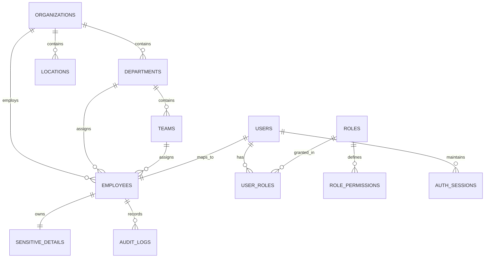

# MantraCare HRMS & Payroll — Database Architecture (Turso / libSQL)

> **Database Engine:** Turso / libSQL  
> **ORM:** Drizzle ORM (TypeScript)  
> **Migration Pattern:** Version-controlled migrations via Drizzle Kit  
> **Security Model:** Centralized Application-Level Data Scope Enforcement

---

## 1. Database Overview & Technology Rationale

The MantraCare Programs ecosystem utilizes **Turso** (distributed libSQL) for the HRMS & Payroll database:
* **High Performance Edge/Embedded**: Extremely low-latency queries powered by SQLite/libSQL.
* **Separation of Environments**: Dedicated local dev SQLite database (`file:local.db`), remote staging Turso database, and remote production database (`libsql://[slug].turso.io`).
* **Zero Client-Side Exposure**: Turso credentials (`TURSO_DATABASE_URL`, `TURSO_AUTH_TOKEN`) are strictly consumed by server-side routes and actions. They are never exported or bundled into browser code.

---

## 2. Entity-Relationship Model (Schema)



---

## 3. Schema Definitions

### 3.1 `organizations`
* `id` (TEXT, PK): UUID
* `name` (TEXT): "MantraCare Global"
* `slug` (TEXT, UNIQUE): "mantracare"
* `created_at` (INTEGER)

### 3.2 `departments`
* `id` (TEXT, PK): UUID
* `organization_id` (TEXT, FK): Ref `organizations.id`
* `name` (TEXT): e.g. "Engineering", "Human Resources", "Finance"
* `code` (TEXT): "ENG", "HR", "FIN"

### 3.3 `locations`
* `id` (TEXT, PK): UUID
* `organization_id` (TEXT, FK)
* `name` (TEXT): e.g. "Delhi HQ", "Bangalore Office", "Remote"
* `country` (TEXT): "IN"

### 3.4 `teams`
* `id` (TEXT, PK): UUID
* `department_id` (TEXT, FK)
* `name` (TEXT): "Frontend", "Backend", "Recruiting"

### 3.5 `users` (Platform Identity Mapping)
* `id` (TEXT, PK): UUID (Internal HRMS User ID)
* `platform_user_id` (TEXT, UNIQUE): ID returned by `https://api.mantracare.com/user/user-info`
* `email` (TEXT, UNIQUE)
* `name` (TEXT)
* `status` (TEXT): `'ACTIVE' | 'SUSPENDED' | 'INACTIVE'`
* `created_at` (INTEGER)
* `updated_at` (INTEGER)

### 3.6 `employees`
* `id` (TEXT, PK): Employee ID (e.g. `EMP-001`)
* `user_id` (TEXT, UNIQUE, FK): Ref `users.id`
* `organization_id` (TEXT, FK)
* `department_id` (TEXT, FK)
* `location_id` (TEXT, FK)
* `team_id` (TEXT, FK)
* `manager_id` (TEXT, FK): Self-referential reporting line
* `reporting_hierarchy` (TEXT): JSON array of manager IDs up the chain
* `job_title` (TEXT)
* `employment_type` (TEXT): `'FULL_TIME' | 'PART_TIME' | 'CONTRACT'`
* `joined_date` (TEXT)
* `status` (TEXT): `'ACTIVE' | 'ON_LEAVE' | 'TERMINATED'`

### 3.7 `roles` & `user_roles`
* `roles`: `key` (PK), `name`, `description`, `is_system`
* `user_roles`: `id` (PK), `user_id` (FK), `role_key` (FK), `custom_scope_json` (TEXT)

### 3.8 `sensitive_employee_details` (Confidential)
* `id` (TEXT, PK)
* `employee_id` (TEXT, UNIQUE, FK)
* `basic_salary` (REAL)
* `gross_salary` (REAL)
* `net_salary` (REAL)
* `bank_name` (TEXT)
* `bank_account_number` (TEXT)
* `bank_ifsc` (TEXT)
* `tax_identifier` (TEXT) (e.g. PAN / SSN)
* `identity_document_url` (TEXT)
* `updated_at` (INTEGER)

### 3.9 `auth_sessions` & `used_tokens`
* `used_tokens`: `token_hash` (TEXT, PK), `used_at` (INTEGER), `expires_at` (INTEGER)
* `auth_sessions`: `session_id` (TEXT, PK), `user_id` (TEXT, FK), `expires_at` (INTEGER), `created_at` (INTEGER), `revoked_at` (INTEGER), `ip_address` (TEXT), `user_agent` (TEXT)

### 3.10 `audit_logs` (Tamper-Evident Append-Only Log)
* `id` (TEXT, PK): Monotonic or UUID
* `timestamp` (INTEGER)
* `actor_user_id` (TEXT)
* `actor_employee_id` (TEXT)
* `action` (TEXT): e.g. `"EMPLOYEE_CREATED"`, `"SALARY_MODIFIED"`, `"ROLE_ASSIGNED"`
* `target_entity` (TEXT): `"employees"`, `"sensitive_details"`, `"roles"`
* `target_id` (TEXT)
* `changes_json` (TEXT)
* `ip_address` (TEXT)
* `user_agent` (TEXT)
* `prev_hash` (TEXT): SHA-256 hash of the immediately preceding record
* `current_hash` (TEXT): SHA-256 hash of `prev_hash + log_record_payload`

---

## 4. Server-Side Data Scope Enforcement Engine

Since SQLite/libSQL does not support PostgreSQL Row-Level Security (RLS), security is enforced programmatically in the Data Access Layer (DAL) through `withDataScope`:

```ts
export async function getScopedEmployees(session: AuthenticatedSession) {
  // Evaluates session.dataScope (SELF, DIRECT_REPORTS, TEAM, DEPARTMENT, LOCATION, ORGANIZATION)
  return db.select()
    .from(employees)
    .where(buildScopeFilter(session));
}
```

Any query attempting to load data outside the caller's authorized scope returns an empty set or throws an authorization error.

